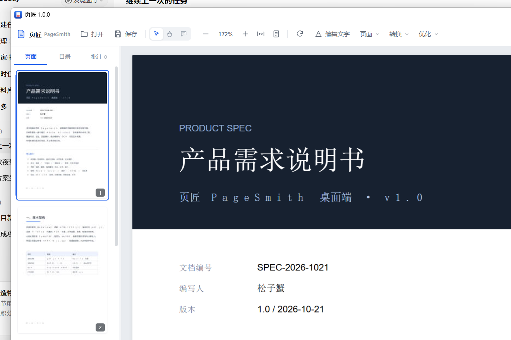

# PDF Studio

本地优先的 Windows PDF 工作站，替代 Adobe Acrobat 的日常使用场景：阅读、批注、
页面编排、格式转换、OCR、压缩加密。**文件全程不出本机**，不联网、不上传。



---

## 功能

### 阅读与批注
- 虚拟化连续滚动，几百页的文档也不卡（只渲染视口附近的页，最多保留 10 张画布）
- 文本层可选可复制、全文搜索并高亮、目录（书签）跳转
- 缩略图侧栏：点击跳页、拖拽重排、右键菜单（旋转/删除/提取/插入）
- 批注：选中文字高亮、下划线、删除线；贴纸便签；批注列表可跳转定位

### 页面操作
- 旋转、删除、提取、移动、反转、插入空白页
- 拆分（每 N 页）、合并多个 PDF、图片合成 PDF

### 文字编辑（工具栏「编辑文字」按钮 / 快捷键 E）
- 点击页面上任意文字进入行内编辑，回车或失焦生效；**清空文字 = 删除**
- 「添加文字」后在页面任意位置插入新文字
- 新文字可设置：**字体**（微软雅黑/宋体/黑体/楷体/仿宋/等线/Arial/Times/Courier）、
  **字号**、**颜色**、**方向**（正向 / 反向 180° / 竖排——字形直立逐字下排）
- 删除走"修订"机制：真正从内容流移除字形（复制不到原文），背景图像与矢量保留
- 撤销栈支持最近 10 步编辑（Ctrl+Z 或工具条「撤销」）
- 编辑的是真实 PDF 文字：改完即可选中、可搜索（空格映射已修正）

### 格式转换

| 方向 | 说明 |
|---|---|
| PDF → Word | `pdf2docx`，保留段落与表格结构 |
| PDF → Excel / CSV | 自动识别表格，丢弃全空列 |
| PDF → 图片 | PNG / JPEG，可指定 DPI |
| PDF → 文本 / HTML | 纯文本流或带样式的 HTML |
| 图片 → PDF | 多图合成，按文件名排序 |
| 文本 → PDF | 内置中文字体排版 |
| Word → PDF | 需本机装有 Word（COM 转换），缺失时给出明确提示 |

### 水印（优化菜单「添加水印…」）
- **文字可换行**，可选字体（与文字编辑同一套系统字体）、字号、颜色、不透明度
- **方向 0–360° 连续可调**（滑块 + 0/45/90/135/180/225/270/315 预设），逆时针约定
- 铺设方式：**单个居中** / **平铺整页**（旋转后仍按矩形支撑函数裁剪，不留死角也不写冗余对象）
- 应用范围：全部页 / 当前页 / 指定页（支持 `1-3,5,8-` 写法）
- 右侧**实时预览**即最终效果（后端用同一段代码渲染，预览不会骗人）
- 水印是真实文字（可搜索、可复制），不是图片，体积几乎不变
- 添加后 Ctrl+Z 可整体撤销；旋转页（/Rotate 90/180/270）自动做角度补偿

### OCR
- RapidOCR（离线 onnxruntime 推理），对扫描件写入**不可见文本层**
- 识别后文档变成可选可搜，版面外观零变化
- 支持中文/英文，首次使用会加载模型（约几秒）

### 优化与安全
- 四档压缩（轻/中/强/极限）：图片降采样 + JPEG 重编码，仅在更小时替换
- AES-256 加密 / 解密

---

## 安装

### 用安装包（推荐）
运行 `PDFStudioSetup-<版本>.exe`，按向导安装。支持"仅当前用户"安装
（无需管理员权限，默认装到 `%LOCALAPPDATA%\Programs\PDFStudio`），
自动创建开始菜单 / 桌面快捷方式，卸载入口在系统"设置 → 应用"里。

### 免安装绿色版
解压 `PDFStudio-win64.zip` 到任意目录，双击 `PDFStudio.exe`。
免安装、无需 Python。首次启动会在 `%USERPROFILE%\.pdfstudio` 建缓存目录。

> 遇到"双击没反应"时，先看 `%USERPROFILE%\.pdfstudio\logs\startup.log`，
> 所有启动期错误都会落在这里。

### 启动报「应用程序控制策略已阻止此文件」怎么办

完整报错形如：

```
ImportError: DLL load failed while importing _mupdf: 应用程序控制策略已阻止此文件。
ModuleNotFoundError: No module named 'mupdf'
```

这不是文件损坏。Windows 11 的**智能应用控制**（Smart App Control）会按 WDAC
策略（Policy ID `{0283ac0f-fff1-49ae-ada1-8a933130cad6}`）拦下**未签名**的原生
DLL，PyMuPDF 的 `_mupdf.pyd` 只是第一个被拦的。系统日志
「Microsoft-Windows-CodeIntegrity/Operational」里能看到对应的 3033 / 3077 事件。

按顺序试：

1. **卸载后重新安装一次** —— 实测最有效（新文件会重新判定，几乎都能通过）；
2. **改用绿色版** `PDFStudio-win64.zip`，解压后直接跑 `PDFStudio.exe`（实测绕过）；
3. **关闭智能应用控制**：Windows 安全中心 → 应用和浏览器控制 → 智能应用控制 → 关闭。
   注意：关闭后要重装系统才能重新打开，请自行权衡；
4. **公司/学校电脑**：请联系 IT 把安装目录加入允许列表（这是 WDAC 策略，普通权限改不了）。

要彻底解决只能给程序**代码签名**（OV/EV 证书），未签名程序在开启 SAC 的机器上
随时可能被拦。

### 从源码运行

```bash
python -m venv .venv
.venv\Scripts\activate
pip install -r requirements.txt
python main.py                 # 或 python main.py 某文档.pdf
```

环境要求：Windows 10/11 + WebView2 运行时（Win11 自带；Win10 若缺，
装一下 [Evergreen Runtime](https://developer.microsoft.com/microsoft-edge/webview2/)）。

---

## 使用

- **打开**：`Ctrl+O`，或直接把 PDF 拖进窗口，或命令行 `PDFStudio.exe 文件.pdf`
- **保存**：`Ctrl+S` 覆盖保存；另存为在「更多」菜单
- **翻页**：`PgUp/PgDn`、`Ctrl+G` 跳页，`Ctrl+F` 搜索
- **缩放**：`Ctrl +/-`、`Ctrl+0` 适应宽度、`Ctrl+1` 整页
- **编辑文字**：`E` 进入/退出，`Ctrl+Z` 撤销编辑，`Esc` 逐层退出

批注是**队列式**的：先画在界面上，`Ctrl+S` 时才真正写入文件，
所以标注过程中不会产生半成品文件。

---

## 项目结构

```
main.py                  入口：本地服务 + WebView 窗口 + 单实例锁
app/
  server.py              本地 HTTP 服务（静态资源 / 文档流 Range / 缩略图 / 上传）
  api.py                 暴露给前端的 ~40 个方法（js_api 桥）
  core/
    doc.py               文档会话：页面操作、批注队列、保存、编辑撤销栈
    edit.py              文字编辑内核：片段读取、修订删除、多方向写入、坐标换算
    convert.py           各种格式互转
    ocr.py               OCR（写不可见文本层）
    watermark.py        水印内核：任意角度、平铺、旋转页补偿、预览渲染
    compress.py         压缩、AES 加密
  web/
    index.html           界面骨架
    css/app.css          样式（浅色专业工具风）
    js/app.js            主控制器：动作分发、对话框、状态
    js/viewer.js         渲染内核：虚拟滚动、文本层、命中高亮
    js/dialog.js         模态框 / 提示条 / 输入框
    vendor/pdfjs/        pdf.js 4.x（含 cmaps 与标准字体）
scripts/
  make_demo.py           生成示例文档
  selftest.py            核心能力自检（23 项）
  test_backend.py        后端集成测试（54 项）
  test_watermark.py      水印几何自测（居中/角度/旋转页/平铺）
  shot.py                按窗口标题截图（开发期验界面）
requirements.txt
PDFStudio.spec           PyInstaller 打包配置
```

架构上只有一层进程：Python 起一个 `127.0.0.1` 的静态服务，WebView2 打开它，
前端通过 `js_api` 反过来调 Python。不需要双进程 IPC，也不需要 Node。

---

## 测试

```bash
python scripts/selftest.py       # 核心 API 能力，23 项
python scripts/test_backend.py   # HTTP 层 + 端到端，40 项
```

界面自检（不需要人盯屏幕）：

```bash
set PDFSTUDIO_SMOKE=1
python main.py sample/产品需求说明书.pdf
```

会输出一行 JSON：标题、顶栏是否存在、缩略图数量、已渲染画布数、遮罩是否隐藏、
正文前 240 字——用来自动判断是白屏还是渲染异常。

---

## 打包

```bash
# 1) 打出应用目录 dist/PDFStudio
python -m PyInstaller PDFStudio.spec --noconfirm --clean

# 2) 生成图标（assets/icon.ico + 网页 favicon）
python scripts/make_icon.py

# 3) 编译安装包 → dist/PDFStudioSetup-<版本>.exe
#    需 Inno Setup 6（installer\PDFStudio.iss）
ISCC.exe installer\PDFStudio.iss

# 4) 绿色版 zip（可选）
python -c "import shutil; shutil.make_archive('dist/PDFStudio-win64','zip','dist','PDFStudio')"
```

产物在 `dist/`：
- `PDFStudioSetup-<版本>.exe` — 安装向导（默认仅当前用户，不弹 UAC；命令行加
  `/ALLUSERS` 可装给全机）。带开始菜单/桌面快捷方式，可从"设置 → 应用"卸载
- `PDFStudio-win64.zip` — 免安装绿色版

图标说明：`scripts/make_icon.py` 用 PIL 绘制（4 倍超采样，16~256px 多尺寸
一并输出），改完脚本重跑即可同步更新 exe 图标、窗口 favicon 和安装包图标。

采用 onedir 而非 onefile：本应用带 onnxruntime/opencv/pymupdf，总量近 300MB，
onefile 每次启动都要解压一遍，冷启动会多等好几秒。

## 许可

- 本项目代码：MIT（见安装包内 license.rtf）
- 注意：核心文档引擎 **PyMuPDF 采用 AGPL-3.0**，以本应用形式对外分发时
  需遵守其条款（开源整个应用或购买商业授权）；pdf.js / RapidOCR / pdf2docx /
  openpyxl / pywebview 均为 Apache-2.0 或 MIT 等宽松许可

---

## 已知坑（改代码前务必看）

这几条都是实测踩出来的，改动相关代码时不要回退：

1. **不要用 `type()` 动态创建 HTTPHandler 子类**。WebView2 的网络进程无法从
   动态类拿到响应，页面会永远白屏。必须用类属性赋值的方式绑定配置。
2. **`js_api` 对象的公开属性会被递归序列化**。持有 `fitz.Document` 这类深对象
   会直接撑爆递归。内部引用一律加下划线前缀（`self._session`），pywebview 会跳过。
3. **WebView2 的用户数据目录是独占的**。两个实例同时跑，后启动的会静默白屏
   （HTTP 一条请求都没有）。所以 `main.py` 有命名互斥量做单实例保护。
4. **给 `.modal-mask` 这类元素设 `display:flex` 会覆盖 HTML `hidden` 属性**。
   CSS 里必须有 `[hidden] { display: none !important; }`。
5. **不要给 `webview.start()` 传 `debug=` / `http_server=`**。实测 pywebview 6.2.1
   显式传这些参数（即便值与默认相同）会让 WebView2 的导航静默失败。
6. **pdf.js 与 PyMuPDF 是两套坐标系**（y 向上/向下 + 页面旋转）。所有跨前后端的
   坐标必须经 `edit.py` 的 `pdfjs_rect / frontend_rect` 转换，旋转过的页面才不错位。
7. **嵌入字体的空格会被提取成 U+00A0**（MuPDF 自动生成的 ToUnicode 缺空格映射）。
   `edit.patch_space_tounicode` 在每次写入后补映射，别删。
8. **TextWriter 的 morph 矩阵在内部 y-up 空间里生效**。给"视觉逆时针 θ"传
   `(cos, sin, -sin, cos)`；但**锚点反解要用共轭矩阵 `-θ`**（页面偏移先被
   y 翻转一次）。旋转页还要把角度补偿 `/Rotate`（`theta = angle + rotation`）。
   全部封在 `watermark.py`，别在外面手写矩阵。
9. **`fitz.Font` 的加载在 MuPDF C 层完成且不持 GIL**。两个线程同时加载同一个
   字体文件会互相卡死（水印预览线程 × UI 请求线程实测撞车）。`edit.py` 的
   `_font_lock` 必须保留。
10. **工具栏上有两类按钮**：动作按钮用 `data-act`，下拉菜单触发器
   （页面 / 转换 / 优化 / 更多）用 `data-menu`。`syncChrome()` 启用按钮时
   两个选择器都要同步 —— 漏了 `data-menu` 就会出现"菜单内容都在、
   按钮却永远点不开"的静默失效。同理，任何 `position: fixed/absolute`
   的浮层（如编辑条）z-index 必须低于顶栏的 40，否则会盖住下拉菜单。
